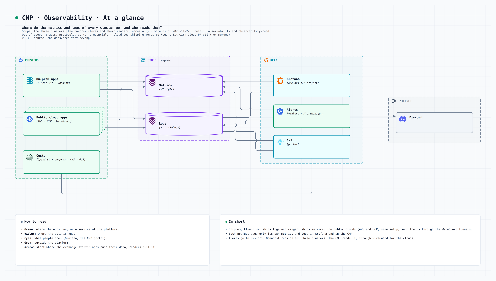
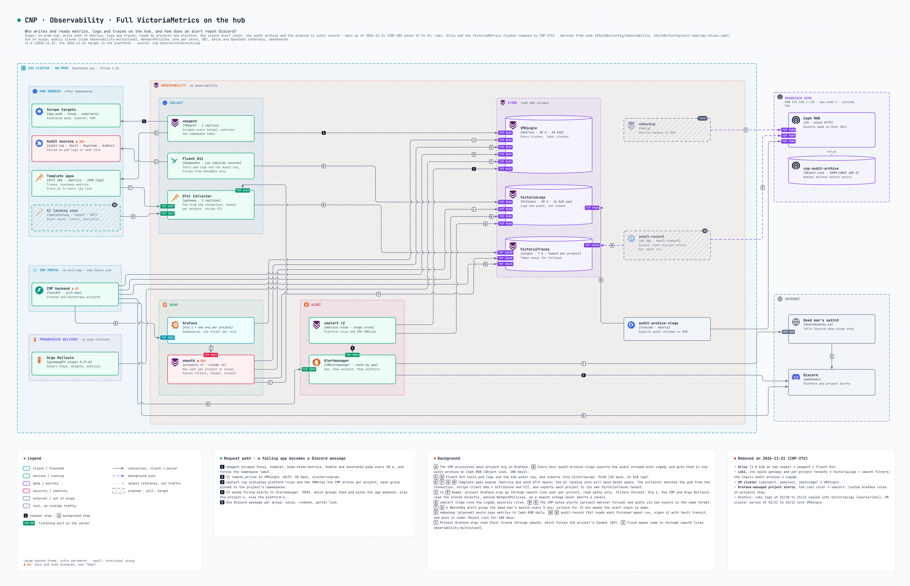
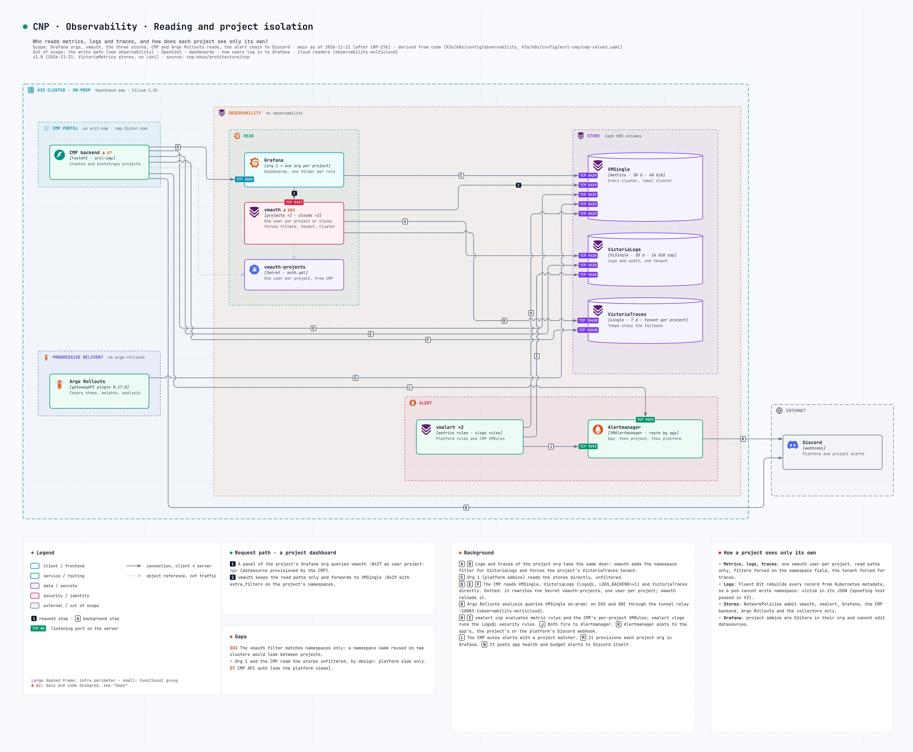
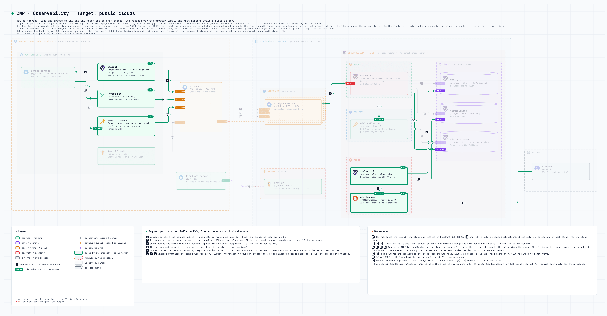
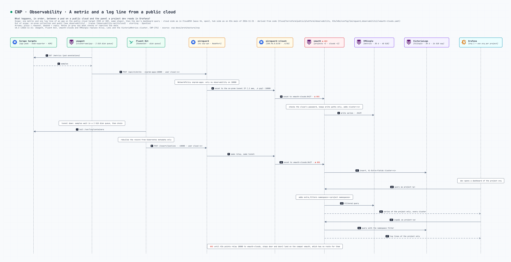

# Observabilité multicluster

Métriques, logs, traces et audit des trois clusters (on-prem, EKS, GKE) finissent sur l'on-prem, dans trois bases VictoriaMetrics : VMSingle (métriques), VictoriaLogs (logs et audit), VictoriaTraces (traces). La collecte tient en deux collecteurs légers (vmagent, Fluent Bit) et un collecteur OpenTelemetry pour les traces ; les alertes suivent une seule chaîne VMAlert → VMAlertmanager → Discord ; Grafana reste l'interface. Loki, Alloy et l'ancien cluster VictoriaMetrics ont été retirés le 21/11/2026 ([CNP-276](https://3istors.atlassian.net/browse/CNP-276)). Les décisions et le plan de migration sont dans le dossier [Observabilité](../10-observabilite/00-index.md). Schémas générés depuis le code avec noodle, sources dans [`architecture/cnp`](https://github.com/3-Istor/cnp-docs/tree/main/architecture/cnp).

## En un coup d'œil

*Où vont les métriques et les logs de chaque cluster, et qui les lit ?*

## Collecte, stockage et alertes sur le hub

*Qui écrit et lit les métriques, logs et traces du hub, et comment une alerte arrive dans Discord ?*

- Métriques : vmagent (un Deployment, `cluster=onprem`) scrape kubelet, kube-state-metrics, node-exporter, Envoy, Hubble et les pods annotés, et écrit dans VMSingle `vmsingle-cnp:8429` (30 jours). VMSingle garde les anciens noms de Service pour Argo Rollouts, OpenCost et les datasources existantes.
- Logs : Fluent Bit (DaemonSet) lit `/var/log/containers` et le journal d'audit k3s, reconstruit chaque enregistrement à partir des métadonnées Kubernetes et l'insère dans VictoriaLogs `vlogs-cnp:9428` (`/insert/jsonline`, un seul tenant, 30 jours, plafond disque 16 Gio).
- Traces : les apps envoient OTLP au collecteur `otelcol-gateway` (4317, 4318), qui associe le pod par la connexion et route chaque projet vers son tenant VictoriaTraces (7 jours).
- Audit (on-prem seulement) : API Kubernetes, Vault, Keycloak, flux refusés Cilium. Le CronJob `audit-archive-vlogs` exporte chaque heure en LogsQL vers un bucket Object Lock. Détail : [Journaux d'audit](06-audit-logging.md).
- Historique : les logs Loki du 22/10 au 15/11 sont copiés dans VictoriaLogs (champ `source=loki`), les séries de l'ancien cluster du 01/11 au 15/11 dans VMSingle.

## Lecture et isolation par projet

*Qui lit les métriques, les logs et les traces, et comment chaque projet ne voit que les siens ?*

- Org Grafana d'un projet : les trois signaux passent par `vmauth` (un utilisateur par projet, chemins de lecture seulement, filtre forcé sur ses namespaces, tenant de traces forcé).
- L'org 1 (plateforme), le CMP (`LOGS_BACKEND=vl`), Argo Rollouts, vmalert et OpenCost lisent les bases directement, derrière des NetworkPolicies.
- Alertes : VMAlert `cnp` (règles de métriques, VMRules par projet écrites par le CMP) et VMAlert `vlogs` (règles LogsQL de sécurité et compteurs de logs) → VMAlertmanager → Discord, routé par app, puis projet, puis plateforme. Un dead man's switch healthchecks.io prévient si la chaîne se tait. Le CMP poste aussi lui-même les alertes de santé et de budget.

## Clouds publics

*Comment les métriques, logs et traces d'EKS et GKE atteignent les bases on-prem ?*

- Sur chaque cloud : vmagent, Fluent Bit et un collecteur OpenTelemetry, avec une file sur disque pendant que le tunnel est coupé ([Cloud#50](https://github.com/3-Istor/Cloud/pull/50), vague V6, pas encore mergée ; les clouds sont éteints).
- Une seule porte : `onprem-apps.cnp-vpn` :18080 → tunnel WireGuard → `vmauth-clouds` :8427, un mot de passe par cloud (Vault `kvv2/observability/clouds/<cloud>`), `cluster=<cloud>` forcé à l'écriture. Argo Rollouts lit par :18083. Le relais 18082 (Loki) n'existe plus.
- Seuls les namespaces `observability` (18080) et `argo-rollouts` (18083) d'un cloud peuvent utiliser ces relais (NetworkPolicy `onprem-apps`).

!!! warning "Écart connu"
    Côté K3s, `k8s/config/wireguard/settings*.env` relaie encore 18080 et 18083 vers les anciens noms `vminsert` et `vmselect` (le vmauth de compatibilité, sans authentification ni label `cluster` forcé), et 18082 vers la Loki gateway. Tant qu'ils ne pointent pas vers `vmauth-clouds:8427`, les écritures des collecteurs de Cloud#50 (chemins et mots de passe de `vmauth-clouds`) n'aboutissent pas (GO1 sur les schémas).

## Parcours d'une métrique

*Que se passe-t-il, dans l'ordre, entre un pod sur un cloud public et le panneau Grafana d'un dev ?*

