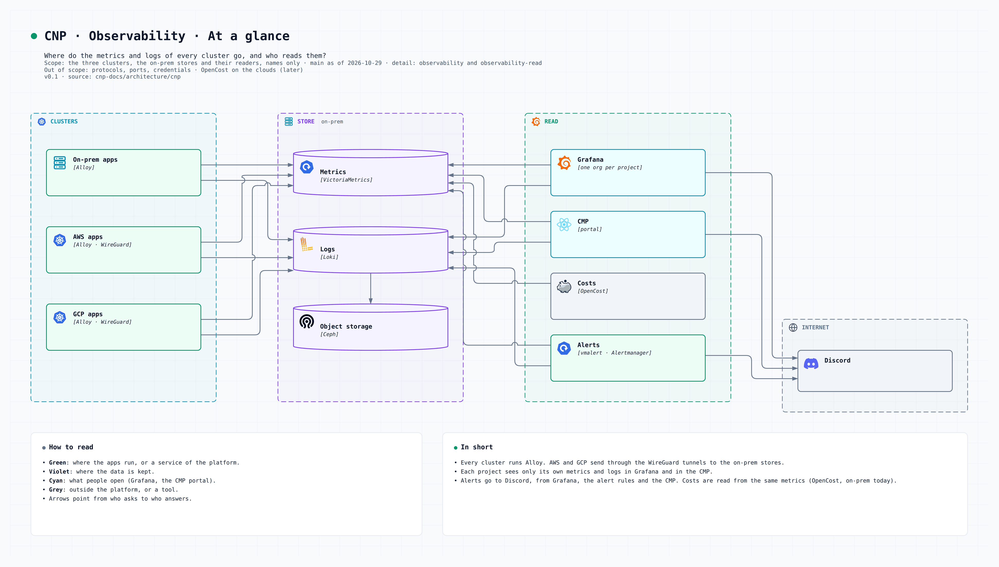
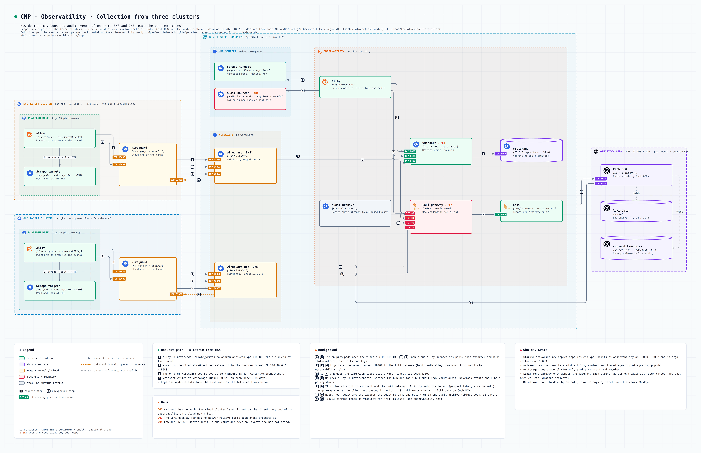
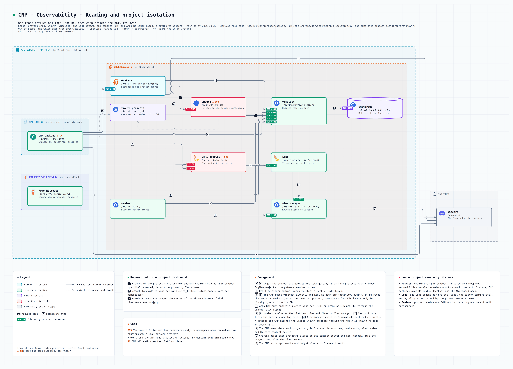
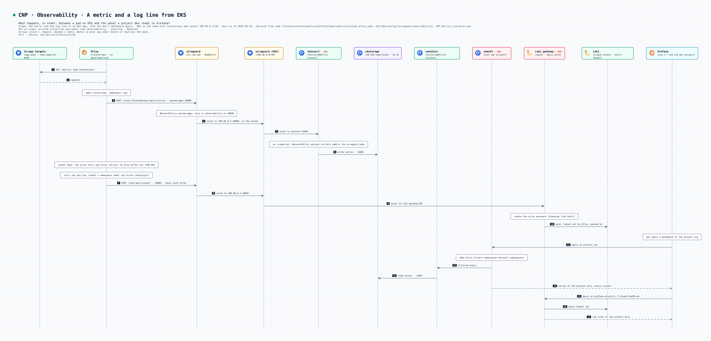

# Observabilité multicluster

Métriques, logs et audit des trois clusters (on-prem, EKS, GKE) finissent sur l'on-prem : VictoriaMetrics, Loki, Ceph RGW. Les clouds n'ont qu'un agent (Alloy) qui pousse par le tunnel WireGuard. Schémas générés depuis le code avec noodle, sources dans [`architecture/cnp`](https://github.com/3-Istor/cnp-docs/tree/main/architecture/cnp).

## En un coup d'œil

*Où vont les métriques et les logs de chaque cluster, et qui les lit ?*

## Collecte

*Comment les métriques, logs et événements d'audit d'on-prem, EKS et GKE atteignent les stockages on-prem ?*

- Clouds : Alloy (`cluster=aws|gcp`) → `onprem-apps.cnp-vpn` :18080 (métriques) / :18082 (logs) → tunnel → pod WireGuard on-prem → `vminsert` / Loki gateway.
- Seuls les namespaces `observability` (18080, 18082) et `argo-rollouts` (18083) d'un cloud peuvent utiliser ces relais (NetworkPolicy `onprem-apps`).
- Le mot de passe Loki d'Alloy cloud vient de Vault (`observability-role`, lecture seule sur `kvv2/observability/loki-clients`).
- Audit (on-prem seulement) : API Kubernetes, Vault, Keycloak, flux refusés Cilium. Archive horaire dans un bucket Object Lock. Détail : [Journaux d'audit](06-audit-logging.md).

## Lecture et isolation par projet

*Qui lit les métriques et les logs, et comment chaque projet ne voit que les siens ?*

- Org Grafana d'un projet : métriques via `vmauth` (un utilisateur par projet, filtre sur ses namespaces), logs via le tenant Loki du projet (`X-Scope-OrgID`).
- L'org 1 (plateforme), le CMP, Argo Rollouts, vmalert et OpenCost lisent `vmselect` directement.
- Alertes plateforme : vmalert et le ruler Loki → Alertmanager → Discord. Alertes projet : règles Grafana et contact points Discord créés par le CMP dans l'org du projet. Le CMP poste aussi lui-même les alertes de santé et de budget.

## Parcours d'une métrique

*Que se passe-t-il, dans l'ordre, entre un pod sur EKS et le panneau Grafana d'un dev ?*

