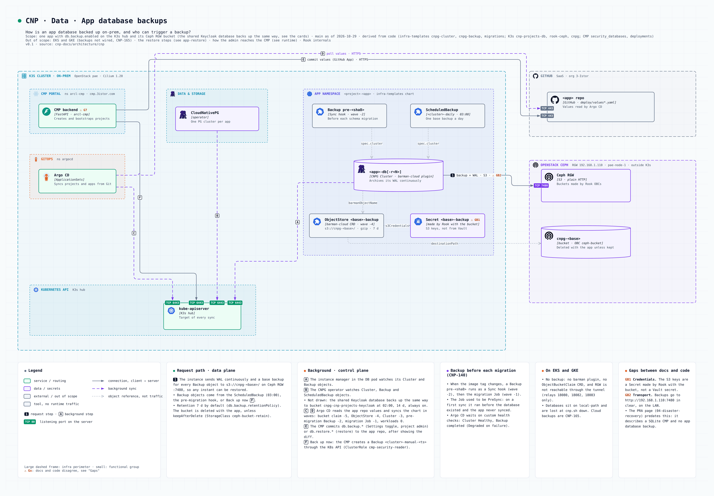
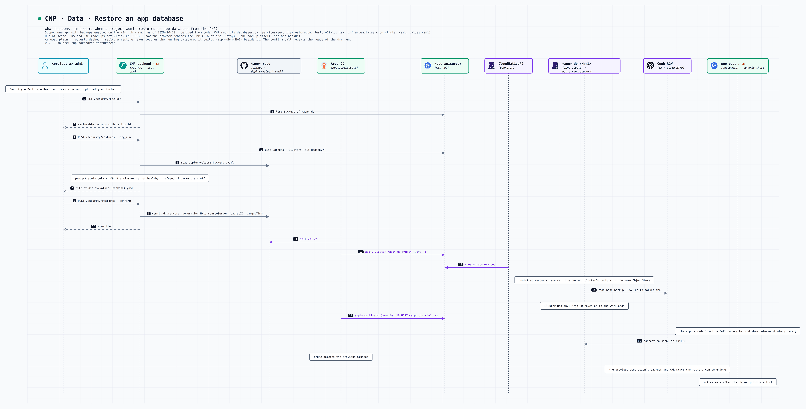

# Sauvegarde des bases applicatives

Les bases CloudNativePG d'une app peuvent être sauvegardées sur le Ceph RGW on-prem (opt-in, `db.backup.enabled`). La base Keycloak partagée l'est toujours. Pas disponible sur EKS/GKE.

## Sauvegarde

*Comment une base d'app est sauvegardée on-prem, et qui peut déclencher une sauvegarde ?*

- Quotidienne à 03:00 plus archivage WAL continu : restauration à un instant donné possible.
- Une sauvegarde précède chaque migration de schéma (ordre des sync waves : bucket, ObjectStore, cluster, backup, migration, workloads).
- Activation et restauration depuis le CMP (onglet Sécurité, réglages de l'app) : le CMP commite dans le repo de l'app, Argo CD applique.

## Restauration

*Que se passe-t-il quand un admin de projet restaure une base depuis le CMP ?*

- Jamais en place : une nouvelle génération de la base est créée depuis la sauvegarde choisie, puis l'app bascule dessus.
- Les sauvegardes de la génération précédente restent dans le bucket : une restauration peut être annulée.
