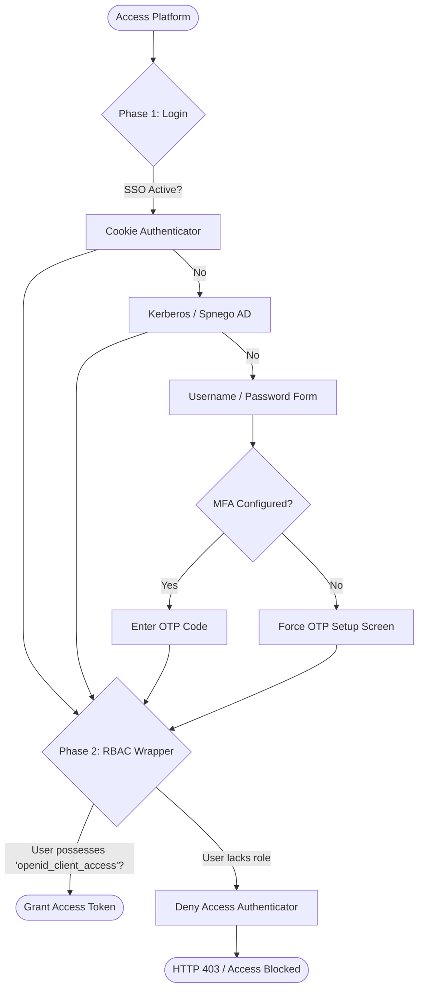

# Identity & Access Management: Keycloak Integration

Keycloak serves as the central Identity Provider (IdP) for the entire CNP ecosystem. It secures the developer portal (CMP), infrastructure platforms (Vault, ArgoCD), and deployed end-user applications via Envoy Gateway edge routing. The central instance runs Keycloak **26.8.1** (see [section 6](#6-version-and-upgrades)).

---

## 1. Custom Theme Extraction Pipeline (DevOps)

To provide a cohesive brand identity for the portal, CNP implements a customized theme named `keycloak-theme-kube-lab`. 

Instead of baking the theme directly into a heavy, custom Keycloak container image, CNP uses a decoupled, declarative **InitContainer Pipeline** with shared Kubernetes volumes (`emptyDir`).

### Theme Synchronization Architecture:

```mermaid
flowchart LR
    subgraph Pod [Keycloak Pod]
        subgraph InitContainer [InitContainer: theme-provider-init]
            Image[ghcr.io/thegostsniperfr/keycloak-theme-kube-lab@sha256:c31626bb...]
            Image -->|Extracts theme files| MountInit[/providers/]
        end

        subgraph MainContainer [MainContainer: keycloakx]
            MountMain[/opt/keycloak/providers/] -->|Loads theme on boot| KC[Keycloak Server Process]
        end

        Volume[(emptyDir: theme-providers)] <-->|Shared Volume| MountInit
        Volume <-->|Shared Volume| MountMain
    end
```

### Declarative Implementation (`k8s/config/keycloak/values.yaml`):
```yaml
# Shared volume configuration
extraVolumes: |
  - name: theme-providers
    emptyDir: {}

# Mount shared volume to the main Keycloak container
extraVolumeMounts: |
  - name: theme-providers
    mountPath: /opt/keycloak/providers

# InitContainer copy-paste mechanism
extraInitContainers: |
  - name: theme-provider-init
    # Pinned: the theme overrides internal login templates and must be retested on every Keycloak bump.
    image: ghcr.io/thegostsniperfr/keycloak-theme-kube-lab@sha256:c31626bb1de27aea9339e6d8fab99d0d4b395c6165ee52f10698083e522dd37a
    imagePullPolicy: IfNotPresent
    volumeMounts:
      - name: theme-providers
        mountPath: /providers
```

On pod startup, the `theme-provider-init` container copies its theme files into `/providers` (the shared volume) and exits. The main Keycloak container then starts, mounts the same volume at `/opt/keycloak/providers`, reads the theme files, and compiles the visual layer.

The theme image used to follow `:latest` with `imagePullPolicy: Always`, so a theme release could break the login page at any pod restart. It is now pinned on a digest: moving it is a deliberate change, made together with a Keycloak bump and followed by a login test.

---

## 2. Browser Authentication Flow (`Browser-3-istor-Login-v4`)

CNP enforces a secure, two-stage authentication and authorization flow. Even if an attacker compromises a user's credentials and passes MFA, Keycloak blocks access at the IdP level if the user lacks the explicit authorization role.



### Flow Configuration Details:

#### Phase 1: Login Wrapper (SSO or Credentials)
1. **Cookie (`auth-cookie`)**: Attempts transparent single sign-on if a browser session is active.
2. **Kerberos (`auth-spnego`)**: Attempts Active Directory SSO handshake.
3. **Forms Fallback (`auth-username-password-form`)**: Prompts for credentials if SSO fails.
4. **Mandatory OTP (`auth-otp-form`)**: Forces users to register and input a TOTP token (using Google Authenticator or similar) upon first login via `keycloak_required_action.totp`.

#### Phase 2: RBAC Deny Wrapper
Once authenticated, Keycloak evaluates the user's role mappings:
* **The Constraint**: The user must possess the `openid_client_access` role.
* **The Action**: If the condition `negate = "true"` (the user does NOT possess the role) is met, Keycloak triggers the `deny-access-authenticator`, blocking token generation.

```hcl
# terraform/auth_flow.tf extract
resource "keycloak_authentication_execution_config" "condition_role_config" {
  realm_id     = keycloak_realm.kube_lab.id
  execution_id = keycloak_authentication_execution.condition_role.id
  alias        = "deny-if-not-3-istor-access"

  config = {
    condUserRole = "openid_client_access"
    negate       = "true" # Triggers downstream deny-access-authenticator if absent
  }
}
```

---

## 3. Project Scopes & Group Mappings

Keycloak maps tenant permissions into OIDC tokens to enforce downstream security boundaries.

### Project Group Convention
When a project is created, the CMP dynamically provisions three groups in the platform realm (`3istor`):
* `project-<project_name>-admins`
* `project-<project_name>-members`
* `project-<project_name>-guests`

Each project realm (see [section 4](#4-project-realms)) has its own flat groups, filled at every broker login from the platform groups above (the mapper re-evaluates the claim each time, so removing someone from the platform group removes them from the realm group at their next login):
* `project-admins` and `project-members`: the project's developers. These are the names applications and `ingress.allowedGroups` see.
* `users`: only in the prod realm `<p>`, created when [customer access](#5-customer-access) is first set to `companies` or `open`, never in `<p>-staging`. It is the realm's default group: Keycloak adds it to **every** new account (sign-ups, accounts an app creates, service-account users, developers at their first broker login), so it does not mean "customer". Apps rely on organization membership instead.

### OIDC Scope Mapping (`groups` scope)
To transmit these memberships securely to downstream consumers (ArgoCD, Envoy Gateway, Vault), Keycloak maps group memberships into the JWT token payload.

```hcl
# terraform/scopes.tf extract
resource "keycloak_openid_client_scope" "groups" {
  realm_id               = keycloak_realm.kube_lab.id
  name                   = "groups"
  include_in_token_scope = true
}

resource "keycloak_openid_group_membership_protocol_mapper" "group_mapper" {
  realm_id        = keycloak_realm.kube_lab.id
  client_scope_id = keycloak_openid_client_scope.groups.id
  name            = "group-mapper"
  claim_name      = "groups"
  full_path       = false # Outputs flat "project-alpha-admins" instead of "/project-alpha-admins"
}
```

### Downstream Consumption Matrix:
* **ArgoCD**: Reads the `groups` claim. If it contains `project-alpha-admins`, it grants sync/override permissions inside the matching `project-alpha` ArgoCD `AppProject`.
* **Envoy Gateway**: Reads the `groups` claim of the project realm token at the edge. If `ingress.allowedGroups` is set and the user tries to access `api.alpha.3istor.com` without `project-members` or `project-admins`, Envoy blocks the connection. Token forwarding is described in the [generic chart](../04-templates/02-helm-generic-chart.md#d-edge-sso-openid-connect-securitypolicyyaml).
* **Vault**: Maps the `groups` claim to a Vault identity group alias, granting access to the `kvv2/data/projects/alpha/*` path.

---

## 4. Project Realms

Each project owns its Keycloak realms for the end users of its apps. Developers log in there through a broker ("Log in with 3istor Platform", identity provider `3istor-platform`) that points at a client of the platform realm.

| Realm | Created | Sign-up | Admin login (Vault, mount `project-<p>`) | App clients |
|---|---|---|---|---|
| `<p>` (prod) | with the project | closed, unless [customer access](#5-customer-access) is `open` | `keycloak-tenant-admin` | `cnp-<p>-<app>` |
| `<p>-staging` | at the first staging activation of an app | never open | `keycloak-tenant-admin-staging` | `cnp-<p>-<app>-stg` |

The staging realm has the same content as the prod one (broker client `broker-<p>-staging` in `3istor`, groups `project-members` / `project-admins` with their mappers, `groups` scope, a local `admin`), so developers log in to staging with their usual account. It is created by the Terraform module `app-templates/templates/k3s-gitops-app/staging-realm` (state `cnp/projects/<p>/_staging-realm`) and destroyed with the project. A project name ending in `-staging` is refused.

* **Wiring**: when staging is turned on, the CMP writes `ingress.realm` and `auth.realm` in `deploy/env/staging/*.yaml`, so the staging route authenticates against the staging realm. An app that validates tokens must therefore read its issuer per environment (`https://auth.3istor.com/realms/<p>-staging`); a prod issuer rejects every staging token.
* **Test accounts on staging**: create them in the staging realm, with the console (`https://admin-auth.3istor.com/admin/<p>-staging/console/`, credentials in Vault) or, with customer access set to `companies` or `open`, through the staging app's own client.
* **Existing staging apps** created before the staging realm existed are moved with `python -m app.scripts.move_staging_realm <deployment id>` (CMP backend, platform admin, one-off per app). The staging OIDC client is recreated in the new realm.
* **Own Keycloak**: an app whose config sets `keycloak_realm_id` keeps that realm in staging. No `<p>-staging` is created for it and the move script has nothing to move.

---

## 5. Customer Access

How the end customers of a project's apps get an account. One mode per project: registration is a realm setting, so all apps of a project share it. `closed` by default.

| Mode | Registration in `<p>` | Organizations, `organization` scope, app rights | Customers get in through |
|---|---|---|---|
| `closed` | closed | left as they are | accounts the project creates |
| `companies` | closed | on | their company's identity provider ([adding a client company](#adding-a-client-company)) or an organization invitation |
| `open` | open | on | self-registration ("Register"), plus the above |

* **Setting**: project settings, Access, "Customer access" (project admins and platform admins). API: `PUT /api/projects/{name}/customer-access` with `{"mode": "closed"|"companies"|"open"}`, refused (`403`) for AI assistants because opening a project to the public is a person's decision. The mode is `spec.customerAccess` in the project registry; a record from before the modes with `selfRegistration: true` reads as `open`.
* **`companies` and `open`**:
    * Organizations are enabled in `<p>` and `<p>-staging`. New accounts land in the default group `users` (created if missing), never in `project-members`.
    * Each app client gets a service account holding `manage-organizations` and `manage-users` of its own realm (never `manage-realm`; Keycloak grants viewing users with `manage-users`), and the `organization` default scope: the access token carries `"organization": ["<alias>"]` without the app asking for the scope (checked on Keycloak 26.8.1). Prod clients `cnp-<p>-<app>` get this in `<p>` only, staging clients `cnp-<p>-<app>-stg` in `<p>-staging` only.
    * Only `open` opens registration, and only in `<p>`. Staging never opens it.
* **Order**: `open` saves the mode, then opens Keycloak; a Keycloak failure answers `502` with the mode saved, and sending it again retries. Every other mode updates Keycloak first, then the registry, so a failure never leaves registration open.
* **Re-applied** when an app is created and when staging is activated, so new clients get their rights. Re-applying the app Terraform keeps the default scopes and service account the CMP added. A Keycloak failure never fails the deployment.
* **`closed`** only closes registration. Organizations, accounts, group and service accounts stay.
* **No e-mail yet**: the project realms have no SMTP, so no address verification and no organization invitation e-mail (an invitation works with registration closed once SMTP exists: the link opens registration for that address only). Until then, companies come in through their identity provider, and the app or a platform admin adds other members.
* **How an app uses it**: with its own client id and secret (already delivered by Vault), the app gets a `client_credentials` token from its realm and calls `/admin/realms/<realm>/organizations` to create an organization and add a member. The app-side recipe is in the template's `using-cnp-services/reference/identity.md`.

### Adding a client company

Platform admins, in the console of `<p>` (`https://admin-auth.3istor.com/admin/<p>/console/`), and in `<p>-staging` for tests. The project must be in `companies` or `open` mode.

1. **Identity provider**: Identity providers, OpenID Connect v1.0 (or SAML v2.0). Alias `<company>-sso` (EPITA: `epita`). Give the company the redirect URI `https://auth.3istor.com/realms/<p>/broker/<alias>/endpoint` and enter the client id and secret it returns. **Trust email: on**: Keycloak 26.8 adds a brokered account to an organization only if its address is verified.
2. **Organization**: Organizations, Create. Name, **alias** (the company id apps store, fixed for good), and the company's e-mail domains. A domain belongs to one organization only.
3. **Link**: the organization's Identity providers tab, link the provider, auto-membership on. A linked provider no longer shows as a button on the login page: people type their e-mail and step 4 sends them to their company, so the page stays the same whatever the number of companies. Unlinked providers (3istor Platform) keep their button.
4. **Routing**: Domains tab, edit each domain: Identity provider = the alias above, Auto redirect on. Someone who types an address of that domain goes straight to the company's login. An account that already has a password is not redirected, so demo accounts keep logging in with theirs.
5. **Company administrators**: the group the app expects (optispace: top-level group `facility-managers`, created once per realm). Add the administrator once their account exists, after their first login through the company.
6. **Check**: log in to the app with an address of the company. The access token carries `"organization": ["<alias>"]`.

Rules: an account belongs to one organization only, and apps refuse an account with several (optispace answers `403 NO_ORGANIZATION`). Never add a member to a second organization.

* **Test company**: a realm of the central Keycloak plays the company's identity provider: users with addresses in a test domain, and one confidential client whose redirect URI is the broker endpoint above.
* **EPITA**: Identity providers, **Microsoft**, alias `epita`, Tenant ID `3534b3d7-316c-4bc9-9ede-605c860f49d2` (EPITA's tenant: only `prenom.nom@epita.fr` accounts get in). Client id and secret come from a Microsoft Entra app registration with the redirect URI of each realm (`<p>` and `<p>-staging`), multi-tenant if it is not registered in the EPITA tenant. Keycloak reads the profile from Microsoft Graph (`User.Read`, there by default). If the tenant blocks user consent, sign-in shows "admin approval required" and EPITA IT has to approve the app. Domain `epita.fr`. The CRI (`https://cri.epita.fr`, used by the Forge) has no dynamic registration: a client there must be requested.

!!! warning
    `manage-users` lets an app edit any user of its realm, including the group membership of brokered developers. A leaked app client secret therefore lets its holder edit any account of that realm: keep app secrets tight.

!!! warning
    The realm is shared by all apps of the project. With sign-up on, any self-registered account passes the SSO of every app exposed to "project users" (SSO without `allowedGroups`). Switch internal apps to "project members" before turning sign-up on.

---

## 6. Version and Upgrades

* **Version**: 26.8.1, set by `image.tag` in `k8s/config/keycloak/values.yaml` of the K3s repository.
* **Procedure**: rehearse on a copy of the Keycloak database, take a `pg_dump` just before, then upgrade. The schema migrations of 26.6 and 26.8 are one-way: the rollback is the previous image **plus** the restored dump, not a downgrade in place.
* **Sessions**: since 26.7, session cookies use SHA-384, so every user logs in once again after the upgrade.
* **Open point**: the Keycloak database has no scheduled backup (follow-up). Until then, the `pg_dump` taken before an upgrade is the only copy.

---
**Next Step**: Continue to [ArgoCD GitOps Delivery Specifications](04-gitops-argocd.md) (or return to the [Project Overview](../index.md)).
