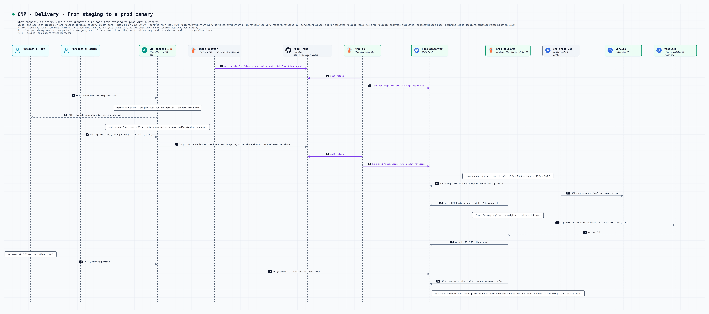

# Promotion et canary

Une release passe par staging, puis est promue en prod par un commit du CMP. En prod, Argo Rollouts la déploie en canary et vérifie le taux d'erreur dans VictoriaMetrics.

*Que se passe-t-il quand un dev promeut une release de staging vers la prod en canary ?*

- Staging : Argo CD Image Updater commite chaque tag `X.Y.Z-rc.N` dans `deploy/env/staging/`. Un projet peut avoir une app en staging sans rien demander ; au-delà, un admin plateforme monte le plafond (`spec.environments[staging].maxApps` dans le registre, `0` l'interdit).
- Promotion : asynchrone. La boucle d'environnement du CMP (toutes les 15 s) enchaîne smoke, suites de l'app, soak, approbation d'un admin si la politique l'exige, puis commite `image.tag@digest` dans `deploy/env/prod/` et pose le tag GitHub `release/X.Y.Z-rc.N` (jamais `vX.Y.Z`, qui relancerait la CI). Ce tag marque la version X.Y.Z comme promue.
- Canary (preset `safe`) : 10 % → analyse → 25 % → pause manuelle → 50 % → analyse → 100 %. Le poids passe par l'HTTPRoute (plugin Gateway API).
- Analyse `cnp-error-rate` : pas de données = non concluant (jamais de promotion sur du silence), `vmselect` injoignable = abandon. Sur EKS/GKE, la requête passe par le relais WireGuard 18083.
- Onglet Release du CMP : créer une release, promouvoir, sauter une étape, abandonner, relancer. Voir ci-dessous.

## Créer une release (« New release »)

Le bouton propose les tags d'après ceux du dépôt, sans rien à saisir :

- Avec staging : tant que la version n'est pas promue, le candidat suivant `vX.Y.Z-rc.(N+1)` ; une fois promue, un patch, minor ou major en `-rc.1`. Sans staging : `vX.Y.Z`.
- Une version est promue quand elle porte un tag `release/X.Y.Z-rc.N` (laissé par une promotion) ou un tag final `vX.Y.Z`. Seule la version la plus récente compte : un candidat plus ancien qu'une version finale est abandonné. Les autres tags sont ignorés.
- Le tag est posé sur le dernier commit de `main` affiché dans la boîte de dialogue ; `409` si `main` a bougé entre-temps. La CI démarre sur le tag, puis Image Updater déploie le candidat en staging.
- L'outil MCP `cut_release` applique la même règle (`bump` : `candidate`, `patch`, `minor`, `major`). Une confirmation donnée à un assistant vaut pour ce tag et ce commit seulement.

## Historique des déploiements et retour arrière

- L'onglet Deployments liste aussi les apps en rolling update, pas seulement les canary : une ligne par révision (ReplicaSet) de chaque Deployment, en staging et en prod, avec les colonnes Env et Composant (cette dernière n'apparaît que si l'app a plusieurs composants). Un Deployment référencé par un Rollout (canary) est exclu : son historique est celui du canary.
- « Roll back » n'apparaît que sur une ligne prod d'une app avec staging, quand elle correspond à une promotion terminée, et jamais sur la version qui tourne en prod. Il relance le retour arrière de promotion existant.
- Ailleurs (pas de staging, ou version jamais promue) : il n'y a pas de retour arrière depuis l'historique, publier une nouvelle release.

## Écart staging / prod

Une carte compare ce qui tourne, rien d'autre : tag d'image, replicas prêts, requests CPU et mémoire de chaque composant. Chaque champ vaut `same`, `differs` ou `unknown`.

- Un composant endormi en staging (offhours, 0 replica prêt) affiche « Asleep » et n'est jamais « différent » : ses champs restent `unknown`.
- La carte est repliée par défaut, avec le nombre d'écarts dans son titre, et se copie en un clic. La carte « Release not enabled » a disparu.
