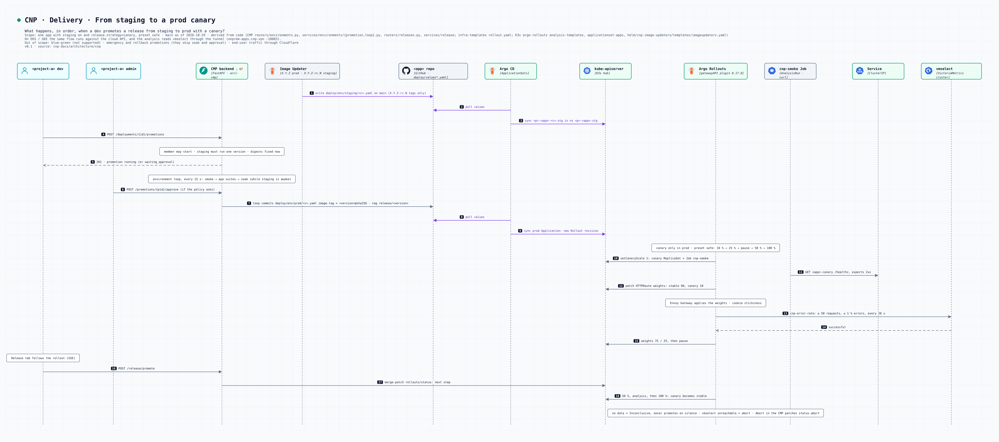

# Promotion et canary

Une release passe par staging, puis est promue en prod par un commit du CMP. En prod, Argo Rollouts la déploie en canary et vérifie le taux d'erreur dans VictoriaMetrics.

*Que se passe-t-il quand un dev promeut une release de staging vers la prod en canary ?*

- Staging : Argo CD Image Updater commite chaque tag `X.Y.Z-rc.N` dans `deploy/env/staging/`.
- Promotion : asynchrone. La boucle d'environnement du CMP (toutes les 15 s) enchaîne smoke, suites de l'app, soak, approbation d'un admin si la politique l'exige, puis commite `image.tag@digest` dans `deploy/env/prod/` et pose le tag GitHub `release/<version>`.
- Canary (preset `safe`) : 10 % → analyse → 25 % → pause manuelle → 50 % → analyse → 100 %. Le poids passe par l'HTTPRoute (plugin Gateway API).
- Analyse `cnp-error-rate` : pas de données = non concluant (jamais de promotion sur du silence), `vmselect` injoignable = abandon. Sur EKS/GKE, la requête passe par le relais WireGuard 18083.
- Onglet Release du CMP : promouvoir, sauter une étape, abandonner, relancer.
