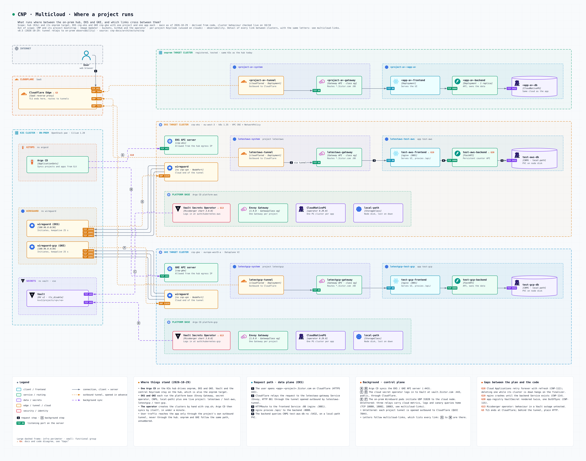
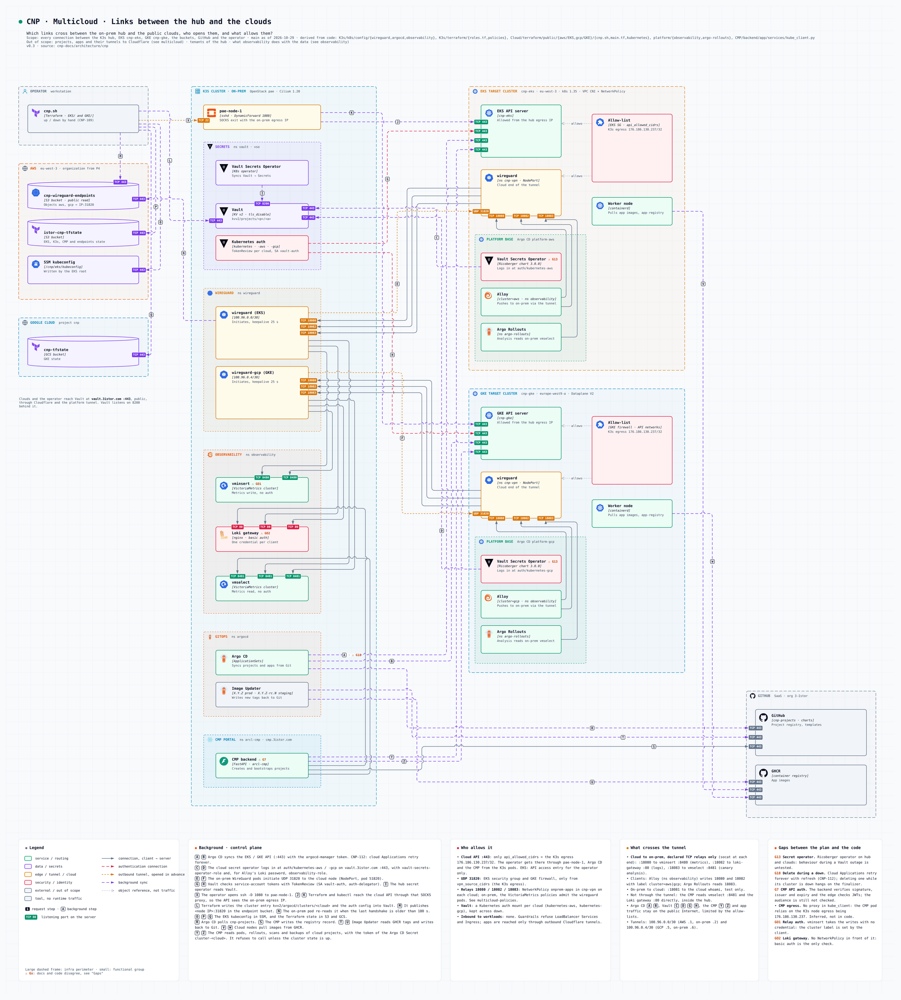
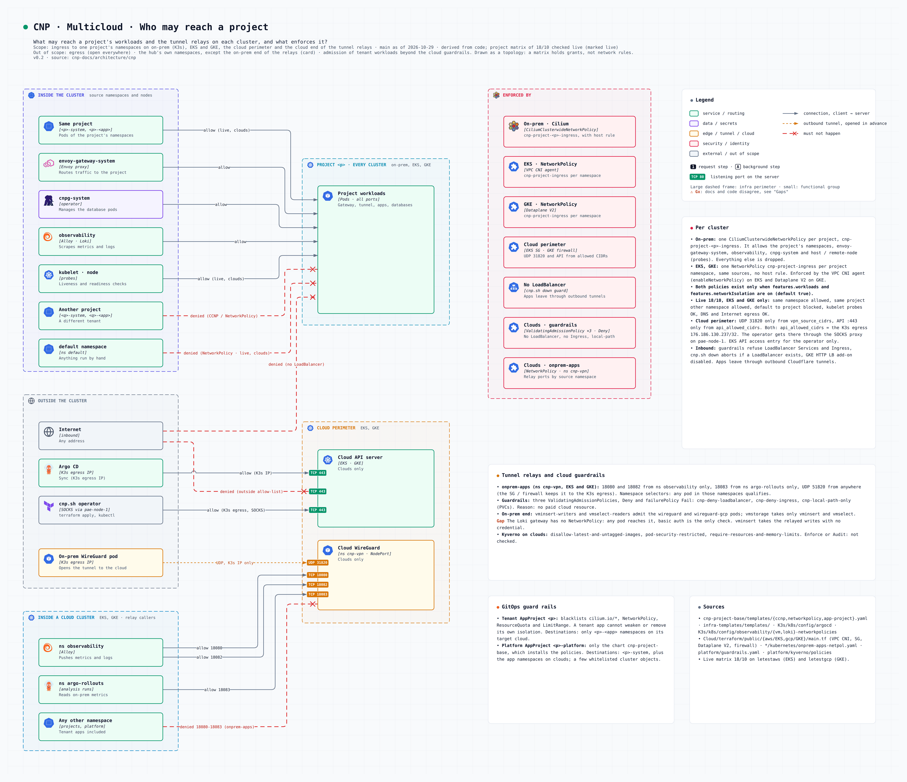
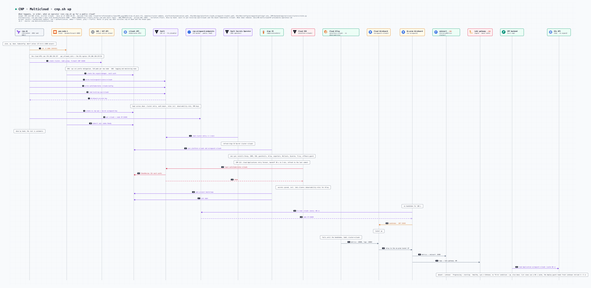
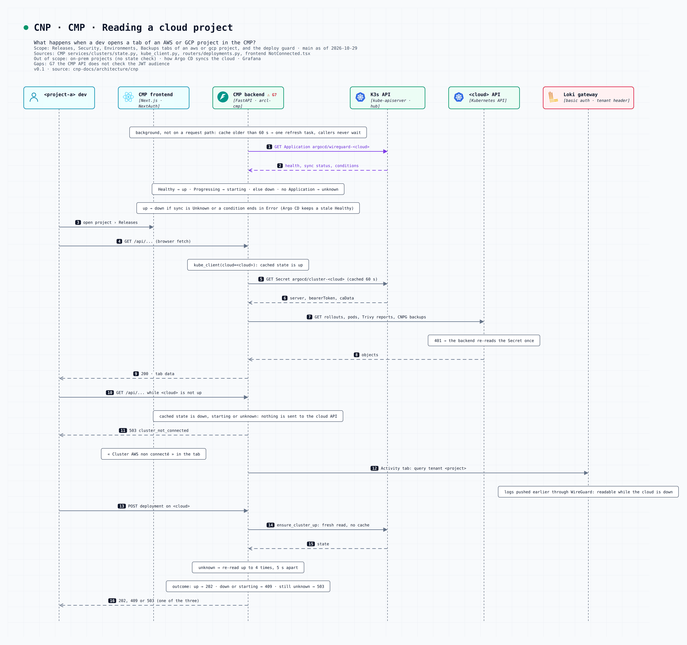
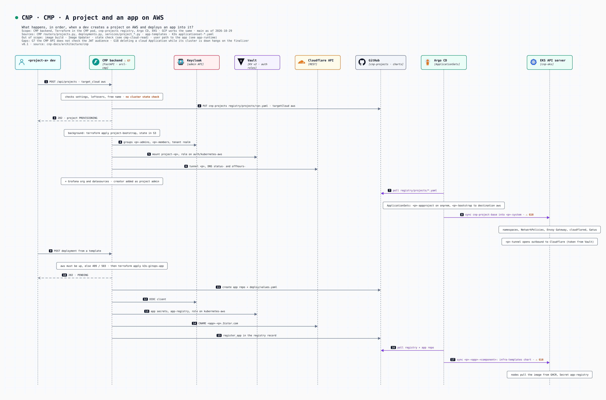

# Schémas

Six vues, générées depuis le code avec noodle. Pour les régénérer : [`architecture/README.md`](https://github.com/3-Istor/cnp-docs/blob/main/architecture/README.md). Pour agir : [procédures opérateur](07-procedures-operateur.md).

## Où tourne quoi

*Ce qui reste sur le hub on-prem, ce qui part avec chaque projet vers son cloud cible, et quels liens traversent.*

- Chemin de requête (plan de données) : l'utilisateur atteint l'app par un tunnel Cloudflare sortant, sur le cluster cible.
- Plan de contrôle (arrière-plan) : Argo CD, Vault, CMP restent sur le hub.
- La carte *Gaps* liste l'écart entre le plan et le code ; les badges `Gx` y renvoient.

## Liens hub / clouds

*Quels liens traversent entre le hub et les clouds publics, qui les ouvre, et qu'est-ce qui les autorise ?*

- Chaque flèche part de l'initiateur : WireGuard est ouvert depuis l'on-prem (UDP 31820), jamais depuis le cloud.
- Argo CD, Vault et le trafic applicatif passent par Internet. Le tunnel porte trois relais cloud → on-prem : 18080 (métriques), 18082 (logs), 18083 (lecture des métriques pour Argo Rollouts).
- Les API des clusters ne répondent qu'à l'IP de sortie on-prem (`api_allowed_cidrs`). L'opérateur y passe par le proxy SOCKS de `pae-node-1`, le CMP avec le jeton du Secret Argo CD `cluster-<cloud>`.

## Qui peut atteindre un projet

*Qu'est-ce qui peut atteindre les workloads d'un projet sur chaque cluster, et qu'est-ce qui l'impose ?*

- Par cluster : CiliumClusterwideNetworkPolicy on-prem, NetworkPolicy sur EKS et GKE, mêmes sources autorisées.
- Garde-fous GitOps : les AppProjects bornent namespaces, destinations et objets cluster.
- Aucun LoadBalancer : pas de chemin entrant vers les workloads. Sur les clouds, trois ValidatingAdmissionPolicy refusent les Services LoadBalancer, les Ingress et les PVC hors `local-path`.
- Les relais du tunnel côté cloud ne sont ouverts qu'aux namespaces `observability` et `argo-rollouts` (NetworkPolicy `onprem-apps`).

## `cnp.sh up`

*Que se passe-t-il, dans l'ordre, quand l'opérateur lance `cnp.sh up` pour un cloud public ?*

- Lire dans l'ordre : Terraform (cluster, nœud, addons), puis ce qui est automatique (Argo, Vault, WireGuard).
- Les étapes d'`up` posent les secrets de liaison : jeton Argo, config Vault, clé WireGuard, endpoint.
- Les Applications cloud réessaient sans fin : tout se resynchronise après un `up` sans action manuelle. L'état du cluster dans le CMP passe à `up` dans la minute.
- Ce qui survit à `cnp.sh down` est listé dans les [procédures opérateur](07-procedures-operateur.md#down).

## Le CMP lit un projet cloud

*Que se passe-t-il quand un dev ouvre un onglet d'un projet AWS ou GCP dans le CMP ?*

- L'état du cluster vient de l'Application Argo CD `wireguard-<cloud>`, relue toutes les 60 s : `up` seulement si Healthy, sync connu et aucune condition `*Error`.
- Cluster pas `up` : aucun appel n'est fait, l'API répond 503 `cluster_not_connected` et l'onglet affiche « non connecté ».

## Un projet et une app sur AWS

*Que se passe-t-il, dans l'ordre, quand un dev crée un projet sur AWS puis y déploie une app ?*

- Le CMP n'appelle jamais l'API du cluster pour créer : il écrit dans `cnp-projects` et les repos d'app, Argo CD déploie sur `targetCloud`.
- Le déploiement d'une app est refusé si le cluster n'est pas `up` ; la création du projet ne l'est pas.
