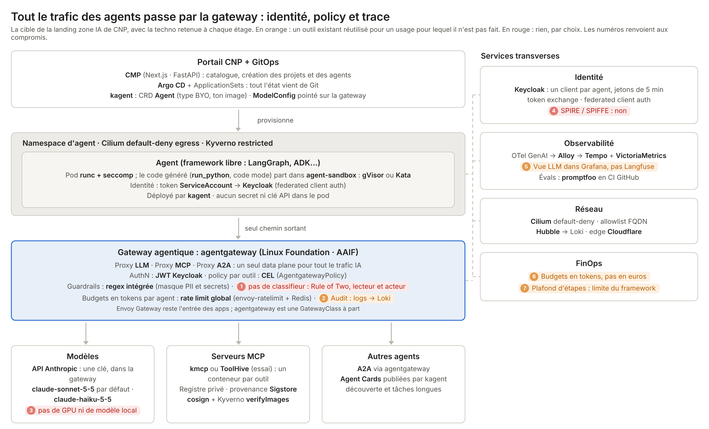

# Stack cible et compromis

Le schéma reprend la vue en couches de la landing zone IA, avec la techno que CNP retient à
chaque étage. Deux couleurs signalent un compromis :

- **orange** : un outil déjà présent est réutilisé pour un usage pour lequel il n'est pas fait ;
- **rouge** : aucun outil, par choix.

Le critère qui tranche est la frugalité : 6 à 8 Go sont disponibles sur le cluster on-prem, la
cible reste d'environ 4 Go pour toute la zone IA, sans être bloquante (révisé le 2026-11-22).
Un outil léger ou utile pour apprendre est pris ; un outil qui consomme beaucoup est écarté
quand la plateforme a déjà de quoi couvrir le besoin.

Source du schéma : `assets/ai-target-stack.html` (rendu en PNG avec Chromium).

## Changements par rapport à l'architecture cible

- **AI gateway (D1) : agentgateway au lieu d'Agent Router.** Au 23 octobre 2026, Agent Router
  (v1.2.0) n'a ni A2A ni guardrails : les deux sont sur la roadmap de sa proposition à l'AAIF,
  sans date. Le filtre `a2a` d'Envoy n'existe que dans la doc 1.41.0-dev, sans configuration, et
  ne figure dans aucune note de version. agentgateway (Linux Foundation, AAIF, 1.6) route déjà
  LLM, MCP et A2A, et porte des guardrails (regex qui masque, webhook, services externes) et des
  budgets en tokens par claim JWT. Envoy Gateway reste l'entrée des apps ; agentgateway est une
  GatewayClass à part. On perd l'argument « un seul data plane Envoy » : c'est un deuxième proxy
  à apprendre et à opérer.
- **Agents : kagent.** Le CRD `Agent` (`kagent.dev/v1alpha2`, type `BYO` pour une image
  LangGraph ou CrewAI) et `ModelConfig` remplacent le chart Helm générique, et chaque agent est
  publié en A2A avec son Agent Card. À vérifier avant de le déployer : que `ModelConfig` pointe
  bien vers la gateway et non vers une clé dans le pod, qu'on peut imposer la `RuntimeClass`, et
  sa consommation mémoire.

- **Identité des agents (D3).** Keycloak 26.6 accepte le token du ServiceAccount Kubernetes à la
  place du secret client (*federated client authentication*, passée en « supported »). Le pod
  de l'agent ne porte donc plus aucun secret, sans ajouter de composant.
- **Métriques.** La base de métriques de CNP est VictoriaMetrics. Les vues qui dessinent
  « Prometheus » pour les métriques GenAI doivent lire VictoriaMetrics.
- **Modèles (2026-11-22) : l'API Anthropic seule.** Plus de Gemini ni de serveur GPU : une clé
  Anthropic dans la gateway, `claude-sonnet-5-5` par défaut et `claude-haiku-5-5` en
  économique (spec D6, §5).
- **Code mode (2026-11-22).** Le modèle écrit du code qui appelle ses outils, exécuté par
  `run_python` dans un sandbox gVisor ou Kata ; les appels d'outils du code repassent par la
  gateway (spec D38).

## Les compromis

| # | Étage | Choix | Pourquoi | On gagne | On perd | Pour aller plus loin |
|---|---|---|---|---|---|---|
| 1 | Gateway | Guardrails : la regex intégrée d'agentgateway masque PII et secrets ; contre l'injection de prompt, la défense est l'architecture (Rule of Two, agent lecteur et agent acteur, un seul outil d'écriture étroit). Pas de classifieur. | Sans GPU, Llama Guard n'a plus où tourner ; un classifieur sur CPU dans le cluster mangerait le budget mémoire ; un appel de modèle par prompt coûte des tokens. | Masquage déterministe sans rien ajouter ; zéro service à écrire ; zéro mémoire de modèle sur le cluster. | La regex ne voit que des motifs connus ; aucun filtre ne lit le sens d'un prompt. La sécurité repose sur les droits des agents, pas sur la détection. | Un webhook qui fait classer le prompt par `claude-haiku-5-5`, seulement si l'essai en montre le besoin (spec D10). |
| 2 | Gateway | Audit : logs d'accès d'agentgateway → Alloy → Loki, puis l'archive Object Lock existante. | La chaîne d'audit de la plateforme existe déjà (CronJob `audit-archive`, bucket RGW en COMPLIANCE 30 jours). | Aucun composant de plus ; mêmes requêtes LogQL, mêmes alertes, même archive. | Loki stocke des logs, ce n'est pas un outil d'audit : la recherche par agent ou par outil dépend des champs posés. 14 jours à chaud par défaut. | Fixer les champs (utilisateur, agent, projet, modèle, outil, tokens, décision), passer le namespace de la gateway à 30 jours, l'ajouter à l'export de l'archive. |
| 3 | Modèles | L'API Anthropic seule, une clé, plafond de dépenses sur la console. Pas de modèle local, d'images ni d'embeddings. | Le serveur GPU n'est plus prévu (2026-11-22) ; un crédit d'environ 10 $ suffit à la démo. | Un backend, une clé, des modèles forts en appels d'outils et en code ; rien à héberger. | Les prompts sortent chez Anthropic ; plus de repli ni de niveau Local ; un projet critical n'active pas l'IA ; coût réel à chaque appel. RAG sans embeddings : recherche agentique (plein texte PostgreSQL). | Un second backend derrière la gateway le jour où un modèle local ou un autre fournisseur devient utile : l'agent ne change pas. |
| 4 | Identité | Pas de SPIRE / SPIFFE. | Keycloak 26.6 donne déjà une identité de workload sans secret (federated client authentication avec le token du ServiceAccount). SPIRE ajoute un serveur et un agent par nœud. | Une brique de moins ; le pod n'a plus de secret. | Pas de SVID pour du mTLS entre workloads ; l'identité reste liée à Kubernetes, ce qui complique la fédération avec EKS et GKE. Le support SPIFFE de Keycloak est encore en preview. | SPIRE quand le mTLS entre agents (utile avec A2A) ou la fédération multicloud deviennent utiles. Léger : bon candidat pour s'amuser. |
| 5 | Observabilité | Traces LLM dans Tempo et Grafana, pas Langfuse. | Langfuse auto-hébergé demande au moins ~21,5 Gio de RAM (web, worker, ClickHouse, Postgres, Redis) : hors budget. | Une seule stack d'observabilité, déjà opérée. | Pas d'interface pensée pour les LLM : pas de lecture confortable des prompts et réponses par session, pas d'annotation ni de score, pas de gestion de prompts. | Arize Phoenix : un conteneur, OTel natif ; Arize fait tourner ses instances hébergées avec 2 Go de RAM et 1 CPU, ici avec un Postgres CloudNativePG. Évals : promptfoo dans GitHub Actions, rien sur le cluster (MIT ; rachat par OpenAI annoncé en mars 2026, à surveiller). |
| 6 | FinOps | Budgets en tokens par agent (rate limit global d'agentgateway, clé = claim du JWT) et OpenCost. | La gateway compte déjà les tokens ; rien de dédié au FinOps LLM. | Le plafond est appliqué à la gateway, par agent et par jour. | Des tokens, pas des euros : la doc d'agentgateway renvoie au calcul tokens × prix ; OpenCost chiffre l'infra, pas les appels. La table de prix est à tenir à la main. | Coût en euros calculé dans Grafana (tokens × prix) ; alerte à 80 %. |
| 7 | FinOps | Plafond d'étapes : limite d'itérations du framework (par exemple `recursion_limit` de LangGraph), posée par le kit d'agent. | La gateway ne voit que des appels, pas les étapes d'un agent. En code mode, une exécution de `run_python` peut enchaîner plusieurs appels d'outils en une étape. | Zéro composant. | Rien ne l'impose côté plateforme : un agent au code maison peut l'ignorer, et une étape de code mode ne compte que pour une. | Le budget en tokens par agent sert de plafond dur ; les appels d'outils du code passent par la gateway et restent comptés et tracés (D38) ; le plafond de dépenses de la console Anthropic est le fusible financier. |

## Sources

- [Keycloak 26.6.0 released](https://www.keycloak.org/2026/04/keycloak-2660-released) et [Federated client authentication](https://www.keycloak.org/2026/01/federated-client-authentication)
- [Agent Router, notes de version](https://theagentrouter.ai/release-notes/) et [proposition à l'AAIF (roadmap)](https://github.com/aaif/project-proposals/issues/18)
- [Envoy, filtre a2a (doc 1.41.0-dev)](https://envoyproxy.io/docs/envoy/latest/configuration/http/http_filters/a2a_filter) et [historique des versions](https://www.envoyproxy.io/docs/envoy/latest/version_history/version_history)
- [agentgateway 1.6](https://agentgateway.dev/docs/standalone/latest/), [guardrails](https://agentgateway.dev/docs/kubernetes/latest/documentation/llm/guardrails/overview/), [budgets](https://agentgateway.dev/docs/kubernetes/latest/llm/cost-controls/budget-limits/)
- [kagent, agent BYO](https://kagent.dev/docs/kagent/examples/langchain-byo/) et [A2A BYO](https://www.kagent.dev/docs/kagent/examples/a2a-byo)
- [Anthropic, tarifs de l'API](https://docs.anthropic.com/en/docs/about-claude/pricing)
- [ToolHive, registre personnalisé](https://docs.stacklok.com/toolhive/guides-ui/registry) et [vérification des serveurs MCP](https://stacklok.com/blog/from-unknown-to-verified-solving-the-mcp-server-trust-problem/)
- [Arize Phoenix, dimensionnement en auto-hébergement](https://community.arize.com/x/phoenix-support/5b5uwoj3d0mw/recommended-specs-for-self-hosting-ecs-with-postgr)
- [Frameworks d'évaluation open source en 2026](https://futureagi.com/blog/best-open-source-eval-frameworks-2026)
- Chaîne d'audit existante : `docs/01-architecture/06-audit-logging.md`
