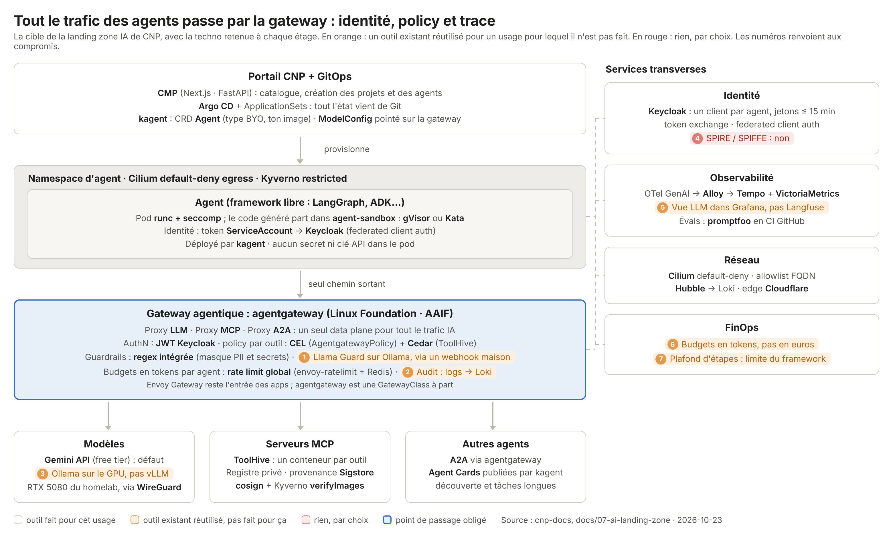

# Stack cible et compromis

Le schéma reprend la vue en couches de la landing zone IA, avec la techno que CNP retient à
chaque étage. Deux couleurs signalent un compromis :

- **orange** : un outil déjà présent est réutilisé pour un usage pour lequel il n'est pas fait ;
- **rouge** : aucun outil, par choix.

Le critère qui tranche est celui de l'architecture cible : environ 4 Go de mémoire pour toute la
zone IA sur le cluster on-prem. Un outil léger ou utile pour apprendre est pris ; un outil qui
consomme beaucoup est écarté quand la plateforme a déjà de quoi couvrir le besoin.

Source du schéma : `assets/ai-target-stack.html` (rendu en PNG avec Chromium).

## Quatre changements par rapport à l'architecture cible

- **AI gateway (D1) : agentgateway au lieu d'Agent Router.** Au 23 octobre 2026, Agent Router
  (v1.2.0) n'a ni A2A ni guardrails : les deux sont sur la roadmap de sa proposition à l'AAIF,
  sans date. Le filtre `a2a` d'Envoy n'existe que dans la doc 1.41.0-dev, sans configuration, et
  ne figure dans aucune note de version. agentgateway (Linux Foundation, AAIF, 1.6) route déjà
  LLM, MCP et A2A, et porte des guardrails (regex qui masque, webhook, services externes) et des
  budgets en tokens par claim JWT. Envoy Gateway reste l'entrée des apps ; agentgateway est une
  GatewayClass à part. On perd l'argument « un seul data plane Envoy » : c'est un deuxième proxy
  à apprendre et à opérer.
- **Agents : kagent.** Le CRD `Agent` (`kagent.dev/v1alpha2`, type `BYO` pour une image
  LangGraph ou CrewAI) et `ModelConfig` remplacent le chart Helm générique, et chaque agent est
  publié en A2A avec son Agent Card. À vérifier avant de le déployer : que `ModelConfig` pointe
  bien vers la gateway et non vers une clé dans le pod, qu'on peut imposer la `RuntimeClass`, et
  sa consommation mémoire.

- **Identité des agents (D3).** Keycloak 26.6 accepte le token du ServiceAccount Kubernetes à la
  place du secret client (*federated client authentication*, passée en « supported »). Le pod
  de l'agent ne porte donc plus aucun secret, sans ajouter de composant.
- **Métriques.** La base de métriques de CNP est VictoriaMetrics. Les vues qui dessinent
  « Prometheus » pour les métriques GenAI doivent lire VictoriaMetrics.

## Les compromis

| # | Étage | Choix | Pourquoi | On gagne | On perd | Pour aller plus loin |
|---|---|---|---|---|---|---|
| 1 | Gateway | Guardrails : la regex intégrée d'agentgateway masque PII et secrets ; Llama Guard sur l'Ollama du homelab, appelé par un petit webhook maison. | Le webhook d'agentgateway parle son propre format, pas celui d'Ollama : il faut un adaptateur. Un classifieur sur CPU dans le cluster mangerait le budget mémoire. | Masquage déterministe sans rien ajouter ; classification rapide sur GPU ; zéro mémoire de modèle sur le cluster. | Un petit service à écrire et maintenir ; dépend du homelab et de WireGuard ; partage le GPU avec l'inférence. Il faut choisir : bloquer ou laisser passer si le homelab tombe. La regex ne voit que des motifs connus. | Fail-closed pour les projets sensibles, mode `Audit` avec alerte pour les autres. |
| 2 | Gateway | Audit : logs d'accès d'agentgateway → Alloy → Loki, puis l'archive Object Lock existante. | La chaîne d'audit de la plateforme existe déjà (CronJob `audit-archive`, bucket RGW en COMPLIANCE 30 jours). | Aucun composant de plus ; mêmes requêtes LogQL, mêmes alertes, même archive. | Loki stocke des logs, ce n'est pas un outil d'audit : la recherche par agent ou par outil dépend des champs posés. 14 jours à chaud par défaut. | Fixer les champs (utilisateur, agent, projet, modèle, outil, tokens, décision), passer le namespace de la gateway à 30 jours, l'ajouter à l'export de l'archive. |
| 3 | Modèles | Ollama sur la RTX 5080 du homelab, pas vLLM. | Un seul GPU de 16 Go, un usage de labo. | Un binaire, beaucoup de modèles, changement de modèle à chaud, API compatible OpenAI. | Moins de débit sous charge concurrente que vLLM, moins de réglages de production. | vLLM si plusieurs GPU ou beaucoup d'appels simultanés. |
| 4 | Identité | Pas de SPIRE / SPIFFE. | Keycloak 26.6 donne déjà une identité de workload sans secret (federated client authentication avec le token du ServiceAccount). SPIRE ajoute un serveur et un agent par nœud. | Une brique de moins ; le pod n'a plus de secret. | Pas de SVID pour du mTLS entre workloads ; l'identité reste liée à Kubernetes, ce qui complique la fédération avec EKS et GKE. Le support SPIFFE de Keycloak est encore en preview. | SPIRE quand le mTLS entre agents (utile avec A2A) ou la fédération multicloud deviennent utiles. Léger : bon candidat pour s'amuser. |
| 5 | Observabilité | Traces LLM dans Tempo et Grafana, pas Langfuse. | Langfuse auto-hébergé demande au moins ~21,5 Gio de RAM (web, worker, ClickHouse, Postgres, Redis) : hors budget. | Une seule stack d'observabilité, déjà opérée. | Pas d'interface pensée pour les LLM : pas de lecture confortable des prompts et réponses par session, pas d'annotation ni de score, pas de gestion de prompts. | Arize Phoenix : un conteneur, OTel natif ; Arize fait tourner ses instances hébergées avec 2 Go de RAM et 1 CPU, ici avec un Postgres CloudNativePG. Évals : promptfoo dans GitHub Actions, rien sur le cluster (MIT ; rachat par OpenAI annoncé en mars 2026, à surveiller). |
| 6 | FinOps | Budgets en tokens par agent (rate limit global d'agentgateway, clé = claim du JWT) et OpenCost. | La gateway compte déjà les tokens ; rien de dédié au FinOps LLM. | Le plafond est appliqué à la gateway, par agent et par jour. | Des tokens, pas des euros : la doc d'agentgateway renvoie au calcul tokens × prix ; OpenCost chiffre l'infra, pas les appels. La table de prix est à tenir à la main. | Coût en euros calculé dans Grafana (tokens × prix) ; alerte à 80 %. |
| 7 | FinOps | Plafond d'étapes : limite d'itérations du framework (par exemple `recursion_limit` de LangGraph), posée par le kit d'agent. | La gateway ne voit que des appels, pas les étapes d'un agent. | Zéro composant. | Rien ne l'impose côté plateforme : un agent au code maison peut l'ignorer. | Le budget en tokens par agent sert de plafond dur. |

## Sources

- [Keycloak 26.6.0 released](https://www.keycloak.org/2026/04/keycloak-2660-released) et [Federated client authentication](https://www.keycloak.org/2026/01/federated-client-authentication)
- [Agent Router, notes de version](https://theagentrouter.ai/release-notes/) et [proposition à l'AAIF (roadmap)](https://github.com/aaif/project-proposals/issues/18)
- [Envoy, filtre a2a (doc 1.41.0-dev)](https://envoyproxy.io/docs/envoy/latest/configuration/http/http_filters/a2a_filter) et [historique des versions](https://www.envoyproxy.io/docs/envoy/latest/version_history/version_history)
- [agentgateway 1.6](https://agentgateway.dev/docs/standalone/latest/), [guardrails](https://agentgateway.dev/docs/kubernetes/latest/documentation/llm/guardrails/overview/), [budgets](https://agentgateway.dev/docs/kubernetes/latest/llm/cost-controls/budget-limits/)
- [kagent, agent BYO](https://kagent.dev/docs/kagent/examples/langchain-byo/) et [A2A BYO](https://www.kagent.dev/docs/kagent/examples/a2a-byo)
- [ToolHive, registre personnalisé](https://docs.stacklok.com/toolhive/guides-ui/registry) et [vérification des serveurs MCP](https://stacklok.com/blog/from-unknown-to-verified-solving-the-mcp-server-trust-problem/)
- [Arize Phoenix, dimensionnement en auto-hébergement](https://community.arize.com/x/phoenix-support/5b5uwoj3d0mw/recommended-specs-for-self-hosting-ecs-with-postgr)
- [Frameworks d'évaluation open source en 2026](https://futureagi.com/blog/best-open-source-eval-frameworks-2026)
- Chaîne d'audit existante : `docs/01-architecture/06-audit-logging.md`
