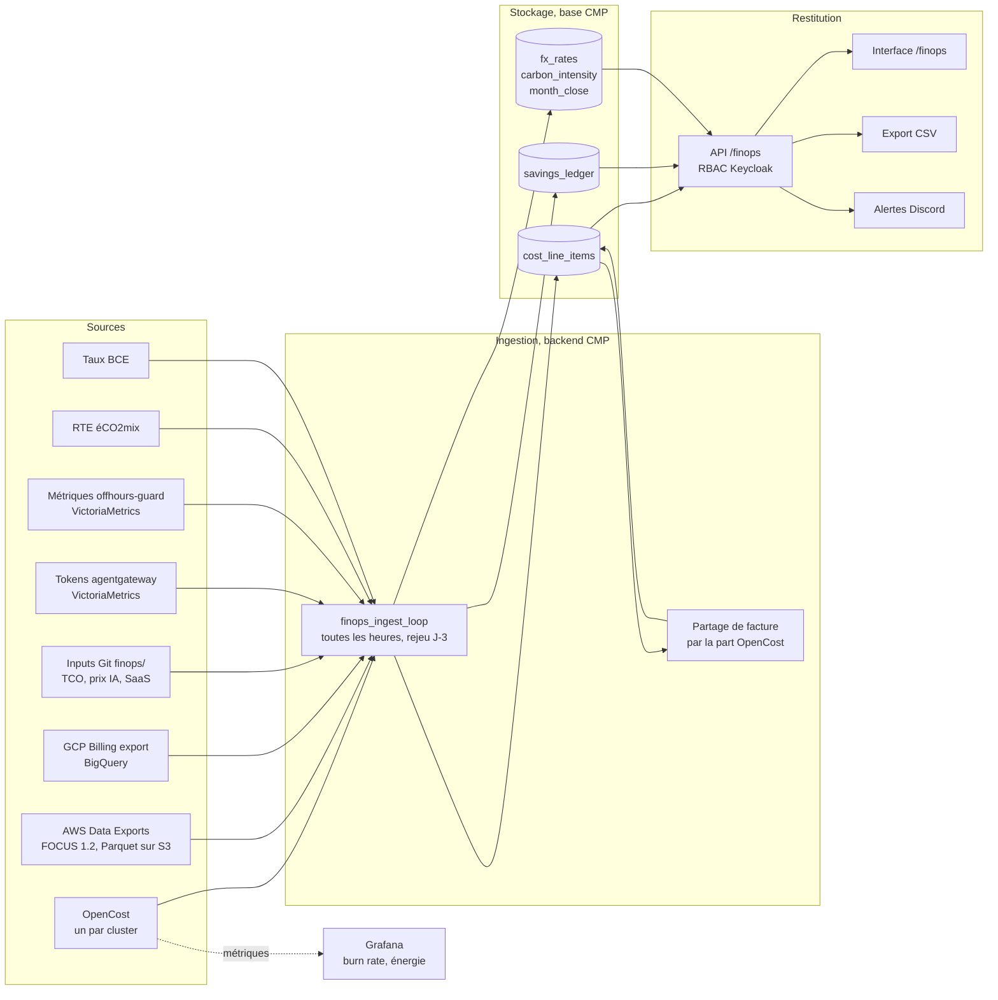

# Architecture

Quatre étages : les sources, l'ingestion, le stockage pivot, la restitution. Le backend de
la CMP héberge l'ingestion, la base et l'API. Rien de nouveau n'est exposé sur internet.

## Vue d'ensemble

Deux chemins mènent aux chiffres. Le chemin comptable passe par l'ingestion et la base :
c'est lui qui alimente l'interface, les budgets et les exports. Le chemin opérationnel
reste dans VictoriaMetrics : Grafana y lit le burn rate en €/h, l'énergie et l'inoccupation.

## Les sources

| Source (`x_source`) | Ce qu'elle apporte | Base du montant | Fréquence |
|---|---|---|---|
| `opencost` | Allocation par namespace et par ressource (CPU, RAM, GPU, volumes, réseau) | `tco` on-prem, `list_price` cloud | Journalière, rejeu J-3 |
| `aws_focus` | Lignes de facture AWS, Parquet lu depuis S3 | `invoice` | J+1, révisé jusqu'à la facture finale |
| `gcp_focus` | Lignes de facture GCP, vue FOCUS BigQuery ou export détaillé | `invoice` | J+1 |
| `aws_split`, `gcp_split` | Part de chaque namespace dans les nœuds facturés | `invoice` | Après chaque lecture de facture |
| `ai_gateway` | Tokens par projet, agent, modèle et backend, valorisés au prix public | `public_price`, ou `tco` pour le serveur GPU | Journalière |
| `saas` | Abonnements hors Kubernetes, une ligne par mois | `invoice` | Mensuelle |

Les prix et abonnements viennent du dossier `finops/` du dépôt K3s, monté dans le backend
par une ConfigMap sur `/etc/cnp-finops`. La table de correspondance des étiquettes est la
même que pour le marquage D-13.

| Dimension | Label Kubernetes | Tag AWS | Label GCP |
|---|---|---|---|
| Projet | `cnp.project` | `cnp.project` | `cnp-project` |
| Application | `cnp.app` | `cnp.app` | `cnp-app` |
| Environnement | `cnp.env` | `cnp.env` | `cnp-env` |

Les clés de label GCP n'acceptent pas le point. L'ingestion normalise les trois graphies en
`cnp_project`, `cnp_app` et `cnp_env`.

## L'appartenance d'un namespace

Un namespace appartient à un projet selon trois règles, dans cet ordre.

1. Il porte le label du projet posé par la CMP. Le nom `<projet>-<app>` donne l'application.
2. Il figure dans `FINOPS_LEGACY_NAMESPACES`, la liste des namespaces antérieurs aux projets CMP. Chacun est son propre projet.
3. Sinon il fait tourner la plateforme : projet `platform`.

L'inoccupation d'OpenCost devient le pseudo-projet `__idle__`. Les nœuds facturés d'un
cloud sont d'abord rangés sous `__cluster__`, puis remplacés par le partage (voir
[Méthodes](03-methodes.md)).

## Le modèle de données

| Table | Rôle |
|---|---|
| `cost_line_items` | Une ligne FOCUS par fait de coût. Clé d'idempotence : `x_source`, `provider_name`, `resource_id`, `charge_period_start`, `charge_category` |
| `savings_ledger` | Une ligne par jour, projet, application et mécanisme, avec le montant évité, l'encaissé, les kWh et le CO2e évités |
| `fx_rates` | Taux de référence BCE par jour et par devise |
| `carbon_intensity` | Intensité moyenne du réseau français par jour, en gCO2e/kWh |
| `month_close` | Mois figés. Une ligne d'un mois clos n'est plus modifiée |
| `cost_centers` | Projet vers centre de coût. Créée, pas encore alimentée |
| `project_budgets`, `cost_alerts`, `budget_alert_states`, `recommendation_states` | Budgets, alertes et recommandations, antérieurs au plan |

Colonnes ajoutées à FOCUS :

| Colonne | Contenu |
|---|---|
| `x_cost_eur`, `x_fx_rate` | Montant en euros, taux de conversion appliqué |
| `x_allocation_method` | `direct`, `opencost`, `prorata`, `manual` ou `unallocated` |
| `x_pricing_basis` | `invoice`, `public_price` ou `tco` |
| `x_energy_kwh`, `x_co2e_kg`, `x_carbon_method` | GreenOps |
| `x_is_final` | La ligne ne sera plus révisée par les passes suivantes |
| `x_is_estimate` | La ligne repose sur une valeur moquée ou sur un taux de repli |

Un ingesteur qui rejoue trois jours ne duplique rien : l'écriture est un upsert sur la clé
d'idempotence. Une panne de lien n'est pas rattrapée par un tampon côté CMP. Elle l'est par
le rejeu, qui relit les trois derniers jours à chaque passe.

## L'API

Toutes les routes sont sous `/finops` et protégées par Keycloak. Un utilisateur voit ses
projets, un administrateur CNP voit tout.

| Route | Rôle |
|---|---|
| `GET /overview`, `/timeline`, `/breakdown`, `/apps` | Vue d'ensemble, série par jour, ventilation, coût par application |
| `GET /savings` | Registre des économies, évité et encaissé séparés |
| `GET /carbon` | Énergie et carbone, méthodes directe et ACV côte à côte |
| `GET /meta` | Fraîcheur des données et présence d'estimations |
| `GET /export.csv` | Les lignes de coût de la vue courante, colonnes FOCUS. Refusé avec 409 tant que `FINOPS_PROVIDER` n'est pas `real` |
| `GET /reconciliation` | Facture contre réparti pour un fournisseur et un mois. Administrateur CNP seulement |
| `/recommendations`, `/budgets/{projet}`, `/alerts` | Parcours antérieurs au plan, branchés sur les données réelles |

Les routes `/forecast` et `/anomalies` du plan n'existent pas encore.
